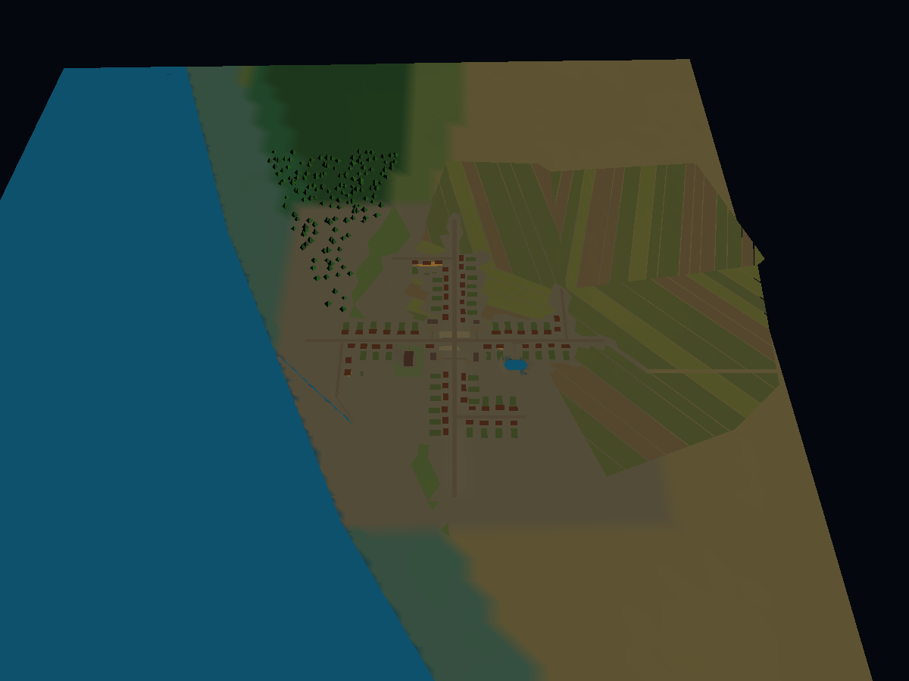

# 広域の分布から、参照時に確定する世界へ

更新: 2026-10-11。設計方針。以下のすべてが実装済みという意味ではない。

## ユーザーが求めること

数十億人の惑星を、人口・居住・農地・森林・水系の分布として色分けする。
拡大、経路探索、NPCの参照など、詳細が必要になった地域だけ具体化する。
初めて具体化する以前の細部は一意でなくてよい。確定後の結果を保存し、
再訪・再起動・キャッシュ破棄後も再利用する。表示のLODと世界の確定は別である。

## 三つの状態

1. 分布のみ: 地域の人口、環境の割合、流水の接続条件がある。家はまだない。
2. 地域計画確定: 集落の場所・人口、土地利用区画、河道・道路の接続を保存した。
3. 詳細確定: 必要な家並み・施設・水際などを保存した。表示メッシュは捨ててもよい。

未確定は「何もない」ではない。広域表示は分布・予定量、確定済み表示は保存された
結果を使い、両者を区別する。遠くから村の存在を表示するだけでは家を生成しない。

## 確定を自由にしてよいものと、受け継ぐ条件

初回の具体化で候補から選んでよい: 未確定区画内部の村位置、道路の曲がり、
個別の家・植生など。乱数や生成器が決めた実際の結果を保存する。

受け継ぐもの: 親地域の人口予算、土地面積、確定済みの地形・水面、隣の区画へ
接続する川・道、すでに確定した集落・区画。上位で正確な位置を決めていない
川は通過帯として表し、初回に帯の内部で河道を確定してよい。

人口の子区画への配分は兄弟をまとめて保存する。先に見た区画が予算を取り切る
ことを避け、親=確定済み子+未確定分+明示的な未配置分を保つ。
面積も同様。人口の収容力不足は人口を黙って消さず、未配置として報告する。

河川は人口と異なり接続グラフが必要。境界の通過点、接続先、流向、水位、
上流からの流入量を共有する。隣の地域との境界記録は両地域で同じIDを参照する。
流量は流入+域内供給-損失-貯留変化=流出で照合する。細流を参照しない段階でも
上流地域の供給をゼロにはしない。閉鎖流域、季節河川、湖沼を海への排水と混同しない。

## 保存の扱い

生成→条件検証→一括保存→公開。表示してから保存する方式は採らない。
並行要求は同じ区画の確定結果を共有する。保存失敗時は未確定のままでエラーを返す。
既存の結果と条件が変わった場合は勝手に上書きせず、明示的な移行が必要。
生成器の更新は未確定区画にだけ適用できる。生成器の版をキーにして保存結果を
見失う設計にはしない。互換性のない既存結果は移行するまで利用を止める。

RAMのLRUキャッシュと世界の保存領域は別。画面外に出たらメッシュやRAMの
コピーを解放できるが、確定済みの世界記録を削除しない。
ブラウザ保存は同じ端末・オリジン内であり、サイトデータ消去に耐えるバックアップ
ではない。持ち運びには世界セーブの書き出し・読み込みが別途必要。

## 着手前の現物と、その後の実装順序

- population: 既に100億人までの入力検査と地域集計がある。ただし収容力で制限される。
- packageSettlements（従来経路）: 全居住地域をループし位置を先に決める。一地域2048件の
  制限で未配置が残る。これを「全球の詳細生成済み」と扱ってはいけない。
- SettlementPages: 保存済み地域ファイルを必要に応じて読む仕組みはある。
- PagedSource（改修前）: 家・農地・道路・植生の生成を遅延できたが、RAMキャッシュだけでは
  「初回確定して永続保存」の契約になっていない。
- 水系: 本川と限定された地域の支流を一つのmanifestに保存する。全地域を細かく
  必要時生成する水系の階層ではない。

進める順序:
1. 初回の確定結果を保存し、再参照する共通経路を既存のローカル生成に接続する。
2. 人口・土地利用の地域を子区画へ分割し、配分を保存する。全球の色分けと同じ正本を使う。
3. 集落の事前全件配置を遅延地域計画へ置き換え、確定した村を既存の家・施設生成へ渡す。
4. 水系の広域接続と流入出条件を保存し、未参照の流域内部だけ詳細化する。
5. 同じ区画境界に道路の接続を追加し、既存集落との矛盾を検証する。
6. 保存世界の書き出し・復元、再起動、複数の参照順、保存失敗を確認する。

完成判定はコードの数ではない。全球の人口ゾーンから任意の地域を開き、村・農地・
川・道が現れ、戻って再び開いても同じで、隣接区画へ続いていることを実画面で示す。

## 2026-10-11 の接続実装と確認範囲

- PagedSourceの既存生成経路に初回確定ストアを接続した。ブラウザではIndexedDB、
  検証・CLIではファイルストアを使える。保存できない結果を成功として返さない。
  ブラウザにIndexedDB自体がない場合は、再生成方式であることを画面に表示する。
- 人口ゾーンは既存の人口集計を正本とし、球面の面積が等しくなる4分割を行う。
  人口だけでなく村・町・都市の数と各人口の合計を保ち、兄弟4区画を一括保存する。
  未適地しか見つからない場合は親の人口を明示的な未配分として残す。
- 相対的な配置の重みは、既存の食料適性と各子区画9点の水面・傾斜から計算する。
  この疎な調査は収容力・洪水安全性・灌漑の保証ではない。
- CLI scripts/materialize-population-zone.mjs は保存世界、保存先、緯度、経度、深さを受け、
  参照した枝だけを分割し、既存の集落配置処理へ実際に渡す。
  すでに全集落位置を持つ保存世界は、別の配置を二重に生成せず移行要求で停止する。
- 実保存世界の一地域では、5階層の配分後、359.568 km²、600人、2村を配置した。
  別プロセスで同じ保存先を開き直して出力JSONが完全に一致した。
- 30億人の集計を5段階、1024区画へ分割する試験でも人口・村町都市数が完全保存される。
  個々の住人や900万村の座標を生成する試験ではない。

次の接続: 新規生成の「人口ゾーンから参照時に村を確定・保存する」を選ぶと、
公開時の全件配置を省略する。全球ビューの接近要求が保存された子区画の分布を読み、
初回の村の配置を確定する。既存の村・施設生成、ラベル、配置確認の入口に接続する。
人口レイヤーは広域の集計色と、参照した地域の局所的な人口密度色を重ねる。
既存の事前配置世界は移行せず、旧カタログをそのまま読む。

配置する区画は32km以下・512集落以下を目安とする固定の分割単位を使う。
これは細部の初回生成を一意に要求するためではなく、親と子に二重に村を置かないため。
一画面の要求は最大64の配置区画、512の探索ノードに制限し、超過時はさらに近づく
必要があると表示する。地図用の分布色は最大128区画・256²画素で、家は作らない。
現在は初回に32MiB以下の粗い世界スナップショットを読み込む。これは将来の
完全なデータページ化ではなく、巨大な高解像度スナップショットは対象外。

未完了: 全域を結ぶ地域間交通計画（隣接ゾーンの候補は下記）、階層水系、ブラウザセーブの持ち運び。ブラウザ実画面での保存・
再起動とWebGL描画の受入も未完了。Node上で同じPagedSourceを通した生成の成功を、
これらの完成と呼ばない。

## 隣接ゾーンの道（追加）

新規に公開する必要時生成の世界には `adjacent-committed-sites@1` を付ける。
この条件は集落カタログと世界の識別子に入り、既に保存した旧世界の畑や道へ後から無断挿入しない。
既存の政策を持たない世界はそのまま開く。生成APIのキャッシュも新しい政策を区別する。

- 辺を共有する確定済みゾーン間で、最寄りの集落対を接続候補として一度保存する。
- カメラ内の集落だけを使って道路網を作り直さない。隣接対のキーと確定結果を再利用する。
- 日付変更線と異なる深さのゾーンに対応する。角が触れるだけのゾーンは対象外。
- 候補の両端距離は60kmまで。空の地域、より長い接続は未接続として記録する。
- 表示対象から最大76kmの範囲を調べ、60km候補と16kmの局所探索余白を含める。128ゾーン・8192集落の予算を超えたら明示的に止め、不完全な近傍を「全件」と扱わない。
- 描画と森林・耕地区画の道路空間確保は同じ候補を使い、実際の地形・水域・集落予約を既存の局所ルーターで検査してから道路にする。

これは全村の連結保証ではない。人口ゼロの帯、長い距離、海峡、通れない地形には上位の地域間交通計画が残る。道路候補が存在することと、通行できる道路が完成したことを区別する。

## 水系を次につなぐ際の根拠と制限

参照した一次資料:
- Génevauxほか (2013), Terrain Generation Using Procedural Models Based on Hydrology: https://cgvlab.github.io/cgvlab/www/publications/Genevaux13ToG/
- MERIT Hydro公式: https://global-hydrodynamics.github.io/MERIT_Hydro/
- Davis (2026), Plate-Local River Generation: https://arxiv.org/abs/2610.00301 （新しいプレプリント。要旨の確認であり、査読済み・全面再現と扱わない）

採用を検討する点は、水系の接続と流域単位の計算を先に確保し、画面の四角い範囲だけで河川を切り落とさないこと。MERITの流向・上流面積・水路幅・排水路からの比高という区別も有用である。人口ゾーンをそのまま流域と呼ぶことはしない。

既存の気候処理は月次で融雪と土壌貯留を計算するが、公開出力は年次の局所供給・集積供給・平均流量相当などが中心である。これを実測流量や季節ごとの河道水位と見なさない。湖の水収支、地下水遅延、流下時間は未実装。世界に既に確定した村・畑・川を、新しい詳細水系で無断に移動させない。水の制約を土地利用の確定より先に保存する順序が必要である。

## 全球の流域参照レイヤー

既存の広域排水グラフから、各セルの排水先ID・上流の陸地面積・内陸終端かどうかを導出し、気候データと一緒に保存する。全球ビューで「流域のまとまり」と「上流から集まる土地面積」を選べる。地点の調査欄にも受け口IDと面積を出す。流域の色は識別用で、川の太さ・水深・湿地の面積ではない。

実際の既存64×32セル入力では、陸地1075セル、受け口261、内陸終端0だった。179msで追加データを求め、既存の水供給・土壌水分・融雪の配列が完全に同じであることを確認した。これは現在の粗い世界の性質であり、現実の流域分布が再現できた証明ではない。特にこの入力には内陸終端が無く、必要なら生成側の改善が別途必要である。

この段階ではローカルの川筋や水面を新しく作っていない。上位の接続を見えるようにした段階である。詳細水系の確定には、ここで示した排水先と局所の地形・既存水面を両立させる処理が残る。新規生成は新しいキャッシュ識別子を持ち、旧保存世界の地形や集落を上書きしない。旧気候ファイルに参照データが無ければ、空の流域を表示せず未対応を伝える。

メモリと参照範囲の補足: 同じ画面内のラベル・地面追従・建物準備は、同じmanifestから復元した粗い世界を共有する。弱参照の所有関係により、世界を閉じた後まで全球キャッシュを固定しない。ラベルを表示するだけの要求では、76kmの地域間道路調査を開始しない。別Workerのメモリは別途必要であり、この共有だけでアプリ全体のメモリ上限を保証するものではない。

## 初回参照で保存する局所水系の計画（地形への設置は未接続）

`scripts/materialize-local-water.mjs world.snapshot.json save-directory parent-river-id point-index`
は、保存済み河川の参照点を中心に約8km四方を調べ、既存の局所排水・河道コンパイラを使って追加支流の計画を保存する。同じ参照点を再び開くと保存値を返し、地形を再調査しない。空の結果も保存する。生成器を更新しただけでは保存結果を置き換えず、元の世界や水供給条件が変わった場合は明示的な移行を要求する。

実世界スナップショットの `river:926:861`、点332では2本・61点の小支流計画を得た。初回2227ms、再読込163msで一致し、元の世界JSONは変化しなかった。別の全面水域に当たる参照では0本になり、その空の結果も再読込で一致した。これらは生成の疎密を示す二つの実例であり、全球を網羅する実装ではない。

現在の戻り値は `installed:false`。表示、既存の村、道路、河床は変えない。先に次の条件を満たす必要がある。

1. 参照領域同士の重複と、既に確定した村・畑・道の領域を同時に管理する。1レコードの原子的保存だけでは複数領域の競合を防げない。
2. 水系を確定してから土地利用を確定する。確定済みの土地利用へ後から川を足して破壊しない。
3. 地面、河床、水面、通行判定が同じ保存済み水系を読む。表示だけの追加では不可。
4. 上位の河川への接続点・水位を固定する。窓の境界に達した未確定流域は海や湖として捏造しない。

今回の局所計画は、境界から切れた集水域や未解決の窪地を保留する既存の制約を維持する。幅と深さは地域の年平均水供給から得るゲーム用の近似であり、洪水位・季節河川・地下水の再現ではない。

### 同じ水系を物理判定へ渡す接続

`createMaterializedWaterSurface` は保存された局所計画から、地面・水深・水位・勾配を共通に読む一時的な物理ビューを作る。元の全球地形は変更しない。別世界の計画、同じIDで異なる内容、領域が重なる複数の独立計画、予約範囲をはみ出す川を拒否する。地形のスナップショットと偽って保存することも拒否し、元の地形と追加の保存記録を一緒に持つ必要を明示する。

上記の実計画61点では、61点すべてで水面と河床を読め、追加の最大掘り下げは0.30mだった。標高の問い合わせと水深計算の標高が一致した。地域集落プランナーにもこの物理ビューを渡せる入口を追加し、配置前に水没条件が変われば配置を拒否することを検査した。

これは自動的に全球ビューへ設置する機能ではない。参照領域の保存単位と所有範囲を確定し、その保存された組を表示・通行・集落の全消費側へ渡す配線が残る。現在の集落生成は、オプションを渡さない限り既存地形のまま同じ結果を返す。

## 追加更新: 水系先行の必要時生成を実際のPagedSourceへ接続

新規の試験世界で `--deferred-population --deferred-water` を併用すると、
`settlement-zone-interior-water@1` を保存世界の識別条件へ含める。既存世界の自動移行やデフォルト有効化はしない。例:

`node scripts/generate-planet.mjs water-first examples/planet/water-first --population=3000000000 --settlements=0 --deferred-population --deferred-water`

一つのローカル人口区画について、区画内に収まる河川調査領域を選び、水系計画を作り、その物理条件を読んで集落を配置する。水系計画と集落の結果を一つの保存レコードとして確定する。他の参照が同時に生成しても、保存された同じ組を読む。人口区画は所有範囲を区切るために使っており、流域と同一視しない。

PagedSourceの地面・水面サンプル、地形準備、施設レシピの入口はこの保存済み水系を読む。Core側にも河川を掘る前の標高参照を追加し、既存河川と追加河川を同じ一度の合成で計算する。二重に掘ることでCoreと描画側がずれることを避ける。まだ確定していない水面は、古い河川一覧だけで視界外と判定しない。

実保存世界を新規政策で公開し直した実行では、2つの保存計画・354点をPagedSourceで読み、354点全てが水域になった。別プロセスのCore物理ビューとの標高・水位の差はともに0m、別プロセスで再読込した計画と全サンプルも完全一致した。最初の実行13.56秒、再読込3.78秒。これはNodeでの本番データ経路の検査であり、ブラウザでの表示・応答性の受入ではない。

メモリ検査では、公開処理・複数の地形サンプラー・比較用ビューを一つに抱えた最初の監査が256MiB制限で失敗した。実行側に不要な比較用サンプラーを作らないよう修正し、公開・本番経路・比較・再読込を独立プロセスで検査した。同じ256MiB制限のまま、本番経路の最終ヒープ約177MiB、再読込約185MiB、比較約162MiBで完了した。ヒープを増やして成功扱いにはしていない。

残る制限:
- 集落のある区画内で完結する小支流が対象。無人地域の必要時水系、区画をまたぐ未確定集水域、全球の詳細水系は未完成。
- 既存の固定集落の周辺は保護し、水系を後から差し込まない。所有範囲に収まらない調査も保留。
- 一度の作業群が保持する追加水系は64計画・32768点まで。同時に必要な領域がこれを超えた場合は明示的に停止する。作業が終わった後の入れ替えについては以下の更新を参照。
- ブラウザでの永続保存・再起動・WebGL確認、微細な川が各LODで読める表示の検査が残る。

### 生成画面からの選択

新規生成フォームに「村の配置より先に小支流も確定・保存（試作）」を追加した。初期状態は未選択。人口の参照時生成を外すと、この選択も解除・無効化する。APIでも依存条件と真偽値を検証し、子プロセスに `--deferred-population --deferred-water` を渡す。水系先行だけ別の保存先キーを追加するため、従来の選択の保存先は変えない。

フォームの実際のハンドラーを軽量なDOM代用品で動かし、選択・解除と送信値を検査した。APIは実際のHTTP要求と記録用子プロセスで、引数の転送・結果の再利用・既存保存版の非変更を検査した。これはブラウザの見た目やWebGLの受入確認とは区別する。

### 長距離移動時の水系メモリ入れ替え

メッシュ構築・地面追従・施設生成の作業範囲を明示し、その作業と入れ子の処理が終わるまで必要な水系を保持する。並行して同じ地形を参照する処理もある場合は、その両方を保持する。全ての作業が終わった後、次の必要領域の読込が成功した時点で、以前の水系をメモリから外せる。保存領域からは削除しない。読込失敗やキャンセルでは以前のサンプラーを壊さない。地形の法線キャッシュも水系変更時に無効化する。

実保存世界をA→B→C→Aと移動するNode実行では、常駐計画は2→0→0→2となり、帰還時の354地点の標高・水位・水深と保存計画は最初と完全一致した。以前の31保存記録も全て不変。途中のB/Cは採用可能な小支流が0本だったため、豊富な水系を持つ多数地域を巡った検証とは区別する。別の80地域の合成入力試験では、常駐1計画のまま移動と再読込を検査した。実世界の最終ヒープは約182MiBで、256MiB上限を変更していない。

道路の短い表示区間から全経路のレシピを作る際も、実際の経路全体と迂回調査範囲を覆う水系を先に読む。短い表示区間だけを調べて、先の川を見落とすことを避ける。これは接続と保存の検査であり、ブラウザの長時間移動・全LODの表示受入は未完了である。

### 表示受入で見つかった未解決事項

保存・地形サンプラーの検査が通っても、見た目はまだ合格していない。実際の本番メッシュとCPU描画では、幅約1.2mの小川がLOD14/16で点々に切れる。約243mの中心線を約25cm間隔の995地点で調べると全地点に水があり、最小水深は約0.295mだった。一方、中心区画の描画三角形を半径方向に照合した468地点中377地点では水面三角形が存在しなかった。水面生成の欠落であり、全体テストの件数をもって解決扱いにしない。

細分化の重み変更、交差範囲を狭める試み、内部スカートの除外、細分化予算の倍増はこの画像の問題を解消しなかったため、採用しなかった。道路の調査を除いた隔離描画でも再現するため、保存水系そのものと道路の待ち時間とは別の表示課題として残す。

読込では、最初の9区画の粗い描画に約95秒、詳細表示では5分以上経っても最初の区画が完成せず試験を中断した。道路の候補を囲む大きな円だけで調査を開始していたため、実際の最大探索矩形を使う保守的な除外判定を追加した。この区画では14候補中8候補が、経路を詳しく生成する前に除外できる。最大の迂回範囲・格子丸め・球面投影の拡大分を含め、道路を直線へ置換したり既存の道を移動したりはしない。残る6候補のコストと、完全な画面応答性の改善は未確認。

### 小支流の水面欠落への修正

細分化を増やす方式の代わりに、保存済み局所水系の川筋から水面メッシュを補う。中心線と左右の位置で実際の水深・水位を読み、乾いた位置では接続を切る。物理的な川幅の内側90%を用い、地図記号として幅を増やさない。タイル境界で切り分け、描画の重なり対策として水位より5mmだけ表示を上げる。元の標高・水位・川幅・保存記録は変更しない。1タイル4096サンプル・8192追加頂点で上限を設け、上限時は未解決表示を明示する。

対象の中心区画を再検査すると、468地点中、水面の欠落0・地面による遮蔽0となった。9区画の水系単独CPU描画は約17.3秒。これは道路・建物の調査を明示的に除外した診断であり、通常画面全体の速度改善とは区別する。岸の角張り、他の河川種別、ブラウザ/WebGLでの受入は残る。現在の対象は参照時に保存した局所計画の半幅4m以下、LOD12以上である。有限サンプル間に未検出の乾いた微小領域がないことまで証明するものではない。

### 道路初回調査の待ち時間

通常経路の1区画検査は120秒で未完成となった。約11.2kmの新規道路が広い格子探索と拡張方向探索へ進む。河川索引の同じセル範囲について候補だけを再利用する変更では、実データ32653区間・6000問い合わせの候補列を完全に維持し、索引単体が158msから33msになった。ただし、通常経路は300秒でも完成しなかった。これを表示速度の問題の解決とは扱わない。索引は階層ごとに直近2範囲・各4096候補以下のみ保持し、標高や水深は近似・キャッシュしない。

現在の表示ワーカーには120秒の期限がある。道路探索を一度のメッシュ要求に最後まで抱え込む構造では、再起動後に同じ調査をやり直してしまう。この長い処理を小分けに進め、完了前の表示を未確定と区別し、確定した結果だけを保存する処理が必要である。単に期限やメモリ上限を引き上げない。

### 道路探索を表示要求から小分けにする

地形メッシュの要求では、道路探索を一度の短い区切りだけ進め、未完なら「途中表示」として地形と水面を返す。ワーカー内の探索状態は次の要求へ引き継ぐ。表示済みの途中区画も再要求され、まだ表示されていない区画を先に埋める。施設側のワーカーも未完の要求を順番に回し、入力やキャンセルを妨げない。画面には「道路を調査中（地形は途中表示）」を示す。

1ソースが保持する未完の道路探索は1件だけ。参照中の領域から外れた未完処理は破棄できるが、確定済みの保存記録は削除しない。地形・水系の読取条件を保持し、ページ不足で探索を再開する場合も未完の値を成功結果として保存しない。途中区画のGPU置換で余裕が足りない場合は、その区画の古いバッファを外せるが、親区画の表示を保持する。

実保存世界の同じ1区画は約9.2秒で途中表示できた（道路4件未完）。9区画では約28.5秒。道路計算を除外した診断ではなく、通常のメッシュ経路で未完処理を正しく分けた結果である。別の12回の参照では、同じ探索イテレータの継続を10遷移で確認し、道路の未完記録は保存されていなかった。合成した実PagedSource入力では最後まで分割実行し、一括処理と同じ道路レシピ・1回だけの保存・再読込を確認した。重い実世界の道路自体の完成、ブラウザ/WebGLの受入、森や建物まで含めた全景の自然さは未完了である。

長い格子辺や橋の候補調査も128サンプルごとに制御を返すようにした。表示要求ごとに最大32区切りを進める。細かく区切った最終版では同じ9区画を約37.8秒、最初の区画を約11.1秒で途中表示した。これは全道路完成時間ではない。保存済みレシピを読む互換経路の不具合を全件検査で検出し、探索器を持たない既存の読み取り経路でも再利用できるように修正した。

## View-scale population summaries (2026-10-12)

Population coloring now has a separate bounded summary query. It stops at the
viewing scale and retains authoritative parent zones when the node/texture budget
is exhausted. It does not call the settlement position planner, detailed roads,
local water materialization, building generation, or vegetation generation.
The ordinary viewer may separately reference those features for labels/terrain.

Four sibling allocations remain committed together. Zooming changes the displayed
summary level, not the previously saved allocations or settlement positions. A
local leaf already eligible for settlement materialization is not split further
by this display path. Global views exceeding the overlay budget keep the existing
whole-world census texture rather than silently dropping population roots.

Only one summary request is in flight. Camera keys use quantized scale/location;
late results for a different view are ignored. The actual saved 100-million-person
world was queried at 3000, 600, 120 and 24 km radii without invoking settlement
materialization. See reports/population-summary-audit-2026-10-12.json.
These colors are estimated population allocation, not certified food capacity or
completed villages. Detailed roads and woodland preparation remain unfinished in
the inspected village; this change does not claim to resolve that dependency.

## Major-water transport referrals (2026-10-12)

The referenced 11.2 km village connection crosses a sampled wet run of about
905 m. Its straight-corridor measurement used the actual runtime water surface
at approximately 5 m spacing; it does not prove that every detour is impossible.
The existing fictional timber-crossing policy allows at most 160 m spans.

For new, uncommitted runtime road assessments, the initial local grid still runs
first. If that grid finds no route, a bounded 20 m straight-corridor survey may
refer a continuous sampled wet run of at least 640 m (four local bridge spans)
to regional crossing planning. This is an explicit heuristic and planning scope
boundary, not a physical impossibility theorem. Smaller waters and successful
local detours retain the existing behavior. A prototype that referred before
trying the initial grid broke a valid-detour regression and was rejected.

The returned status is `requires-regional-crossing-plan`. It contains the sampled
water run and unselected alternatives (another crossing location, ferry/landings,
or major bridge assessment). It contains no constructed bridge, ferry, approach
road or traversable connection. The viewer names these separately as unbuilt
crossing requirements. Existing committed roads are always read unchanged.

This resolves the *local assessment*, not the transport connection. Adjacent
landscape generation can use the actual empty built-road clearance rather than
wait indefinitely for a local bridge which this policy cannot build. The saved
assessment remains stable; a later regional crossing plan must be an explicit
world-planning revision, not a camera-triggered replacement of this record or
of already saved trees/fields. Regional crossing selection and construction are
still unfinished. Do not count these referrals as connected villages.

## Referenced crossing-bank candidates (2026-10-12)

The globe now has an explicit “川を渡る場所の候補” inspection control, limited to
two visible referred connections per click. It uses the existing feature worker
and PagedSource, not a second world. Each surveyed set is independently committed
as `crossing-sites:<connection id>` before it is returned to the UI. Reopening
reads those same candidates; ordinary frame updates do not run this survey.

The current bounded survey uses five parallel transects, 5 m samples, at most
four saved wet runs and 16384 total samples. Both banks must be dry and the
intervening samples must share a named river. Ocean/unknown water is withheld.
The UI can move the camera to either sampled bank. None of these points is yet
an approved ferry landing or bridge foundation; currents, flood behavior,
operating rights and dry approach-road connections remain unassessed.

Actual runtime example: five candidate pairs, 3285 samples, about 1.1 seconds
excluding prior road/world loading; second read succeeds with resurvey disabled.
This is candidate inspection, not completed regional transport. Real browser
acceptance remains unverified.

Related primary references: Galin et al., Authoring Hierarchical Road Networks
(2011), https://cgvlab.github.io/cgvlab/www/publications/Galin11CGF/ describes a
hierarchical road-network approach. Valhalla's official routing API separates
ferry traversal/boarding costs from road travel:
https://github.com/valhalla/valhalla/blob/master/docs/docs/api/route/api-reference.md
These motivate separating connection modes and scales; no historical ferry
technology, hydrodynamic guarantee, code dependency or complete implementation
of either system is claimed here.

## Portable committed-result backup (file adapter)

`node scripts/materialization-archive.mjs export SAVE_DIR NEW_ARCHIVE.json`
exports validated committed records. `node scripts/materialization-archive.mjs import
ARCHIVE.json NEW_SAVE_DIR` restores them to a new directory. Stop all readers and
writers during this operation. Do not point a running viewer at a destination
until import succeeds. A killed import can leave a partial directory: keep it
separate and retry to a different new path. Existing destinations and archive
files are never overwritten. Corrupt values, wrong content hashes, duplicate
identities, non-file source records and wrong filename/key mappings are rejected.

This is a bounded 16 MiB / 10,000-record transfer, not an unbounded planet dump.
It includes the first committed population, water, settlement, field and road
results present in that save directory. The original planet publication
(manifest, snapshot and pages) is still required, with its original identity.
It does not export browser IndexedDB and is not a complete standalone game save.
A restore never reruns generators to invent missing past choices.

### Crossing approach evidence

After the saved five-pair bank survey, a separate 10 m straight-line diagnostic
from each referral endpoint to its corresponding bank found zero wet samples
for all ten approaches; largest sampled grade was about 0.016. This is a finite
terrain/water check, NOT an accepted road: existing parcels, buildings, access
rights, full corridor width and connection to street graphs still need checks.
The saved village/referral geometry was unchanged. Do not equate a bank candidate
or a dry centerline with a built ferry or completed regional transport.

## Browser committed-result transfer

The globe now exposes explicit export/import controls under “確定した世界の結果を保存・復元”.
They transfer this browser origin's committed results for all stored worlds, not
just the current camera region. The same 16 MiB format and validation are shared
with the file CLI. Original planet manifests, snapshots and pages remain separate.
A read-only IndexedDB transaction captures export records. Import validates first,
then uses one read-write transaction: existing byte-equivalent records are kept,
missing records are added, and any conflicting saved choice aborts the entire
transaction. Repeated imports do not overwrite choices. No browser-storage clear
or automatic import occurs. UI duplicate requests are suppressed; errors unlock
the controls and clear the file input so the same file can be retried.

Verification uses a transaction-lifecycle test double and lightweight UI elements;
actual PC-browser IndexedDB, download prompts, PC file dialogs and restart
acceptance remain unverified. The preceding file-only checkpoint described the
implementation before these browser controls were added.

## Default-fetcher snapshot sharing correction

PagedSource previously created a fresh default fetch wrapper per instance, which
prevented the manifest/fetcher/URL identity cache from sharing decoded population
snapshots on the ordinary path. Its default wrapper is now stable within a JS
context. A production publication test constructs two default-fetcher sources,
verifies one snapshot read and the same decoded world object. Explicit custom
fetchers remain isolated. This does not share memory across worker processes,
distinct manifest objects or distinct custom fetch functions, and it is not a
measurement of whole-browser memory usage.

## Opt-in uninhabited-region water

New publications can add `--unpopulated-water` together with
`--deferred-population --deferred-water`. The browser generation form exposes
this separately and clears it when its prerequisites are disabled. The new
`all-zone-interior-water@1` policy has a distinct publication/cache identity;
existing `settlement-zone-interior-water@1` worlds retain their old behavior.

Water-reference traversal includes zero-person cells and their bounded local
partitions, even though ordinary settlement/road queries continue to skip them.
It commits the same water-before-sites bundle, with zero sites where population
is zero. The canonical water sampler, residency, visibility and ground queries
use the same saved plan. Coarse views continue using existing broad hydrology.

This removes the populated-region filter; it does not remove bounded interior
catchment limitations. Survey disks must still fit within a spatial partition,
fixed anchors are protected, and cross-boundary catchments remain withheld.
It is not a claim of globally complete small rivers. Actual derived zero-person
world evidence is in `reports/unpopulated-water-runtime-audit-2026-10-12.json`:
four referenced empty zones, zero settlement positions, one accepted plan with
two profiles/61 points; all61 centerline points are wet in the production sampler.
Separate-process reopen with generation disabled restores identical results.

## Persistence guidance correction

The viewer's status text no longer claims that transfer to another device is
unsupported after the archive controls were added. It now describes first-reference
retention, errors on failed saves, explicit export before clearing site data,
and the separate original planet files plus 16 MiB archive limit. The wording is
a capability description, not proof that browser persistence has succeeded.
The source/UI-string test does not replace real browser restart acceptance.

## Next boundary integration: design decision, not completed implementation

The existing inter-chart river code already validates explicit shared endpoints,
water levels, channel cross-sections and acyclic joins. Reuse those physical
invariants; do not create another unrelated river truth in the renderer.
The climate catchment data already supplies coarse terminal identity and routed
potential supply. Those are parent constraints, not precise local river locations.

The next water ownership unit must be a drainage neighbourhood shared by all
referencing population zones. A population leaf is a census/placement unit and
cannot be assumed to be a complete watershed. Persist a shared boundary record
before either side commits detailed channels or land use. It must identify the
parent drainage, adjoining owners, crossing position and direction, water level,
channel dimensions and the provenance/meaning of any flow estimate. Both sides
read that same winning record; they do not independently sample two endpoints.

First-reference choices may vary between independently created saves. What must
remain invariant is the committed result within one save, its compatibility with
already established neighbours and conservation of the parent's allocated totals.
Camera movement only selects which saved records to load. Missing neighbouring
records do not imply an ocean, a dry boundary, or permission to revise a saved
village. An algorithm that regenerates exactly from a seed is allowed, not required.

Do not remove the current boundary withholding until an actual cross-boundary
channel is compiled and restored through the production surface sampler on both
sides. Acceptance must include opposite visiting orders, reload with generation
disabled, a river across a population-zone boundary, and a near/far view of the
same saved network. Existing saves keep their established ownership and terrain;
a new ownership policy requires a distinct new-world publication identity.

## Retry after browser storage opening failures

A rejected or blocked IndexedDB open is no longer cached forever. A subsequent
explicit save/read/export attempt may reopen it. A late success from an abandoned
blocked request is closed without replacing the newer connection. Version-change
and connection-close events invalidate only their own cached connection. Existing
records and first-writer-wins semantics remain unchanged; failed operations are
reported rather than being presented as saved. Lifecycle tests cover retries,
late events and version changes using a test double, not a real browser.

## Population-independent water ownership

New `--unpopulated-water` publications now select
`shared-water-reference-regions@1`, with a distinct publication/cache identity.
Previously saved `all-zone-interior-water@1` worlds retain their original policy.
Water traversal uses geometric reference regions of at most 32 km (depth capped
at 12), independently of population counts and census subdivision. It does not
allocate population, settlement positions, buildings or roads just to look for
water. Geometry follows the existing equal-area partition, but carries no census.

A water owner commits its bounded plan once. Finer population leaves use that
same plan before placing sites and save its owner/plan identity rather than
copying river geometry into every site record. Runtime water queries load the
same shared owner directly. Thus increasing population and subdividing census
regions no longer shrinks the permitted water survey footprint.

This is a spatial ownership correction, not a solution for complete watersheds:
interior-catchment compilation, protected existing anchors, and unresolved
water-owner boundaries remain. It does not claim to join distinct drainage
owners. Broad hydrology still comes from the saved planetary network.

### Populated-world follow-through

The same production path was exercised in a separate 100-million-person saved
world. Four referenced census regions contain 2,700 people and nine village
positions. Local water gives 61 wet centerline samples across two tributaries.
A village plus eight landscape recipes produced 66 buildings, 154 trees and
109 parcels through the ordinary mesh builder and CPU renderer. The initial
scene attempt hit the audit's 240-second timer; saved results were retained.
The next attempt completed in about 204 seconds. Once all nine recipes existed,
reopening with generation disabled took about 41 seconds and produced a
byte-identical PNG. This is not a browser frame-time measurement.

The cross-shaped street layout and regular parcels still look mechanical;
this is persistence/integration evidence, not acceptance of natural settlement
quality. Black lies outside the bounded nine ground tiles. The detailed input,
output, timings and replay hash are in the existing water runtime audit report.

### Avoid repeating the unchanged base-world planner

For canonical immutable worlds, regions without an added local channel reuse
one private base planner. No-local-water leaves no longer copy the full base
just to read an unused river network, and water-enabled page initialization
does not create another unused planner. Physical-water-specific planners still
use their own actual modified surface. A WeakMap releases the shared planner
when its restored world is no longer referenced.

In one isolated actual five-region comparison, snapshot calls fell from 10 to 1
and site planning from 8.25 seconds to 2.16 seconds. All five outputs matched the
previously saved site records exactly; existing storage was read-only and test
choices were committed only to temporary memory. This does not measure whole
scene startup, new water surveys or browser performance.

### Regional drainage before the fine first-reference survey

The opt-in unpopulated-water publication now selects
`shared-regional-water-regions@1`. Existing manifests retain their original
policy and save keys. New regional owners have a separate ID prefix and a
maximum angular-ground span of 256 km. A roughly 64 km survey square and its
46.4 km enclosing support radius must fit entirely in one owner, outside the
reserved footprints of already authored settlements. The owner is not a claim
that every point in that region has detailed hydrology.

One atomic saved plan contains two stages:

1. A 129 × 129 survey at 512 m spacing compiles regional tributaries.
2. A 129 × 129 survey at 64 m spacing sees those actual physical channels and
   compiles finer tributaries around the same reference point.

The combined record, including empty outcomes, is saved before settlements or
roads use its terrain. Both scales share one footprint, so independently saved
parent/child overlays cannot disagree. This does not change the base snapshot
or re-carve already committed worlds. On re-reference the saved record is used;
there is no requirement that another fresh world would choose the same result.

A new 100-million-person diagnostic world selected one such plan with 47
profiles and 3,472 channel points. All points sampled as wet through the actual
PagedSource physical surface. Four queried census zones held 2,700 people and
nine settlement sites. A separate restart with generation forbidden returned
identical zones, site count, water plans and all sampled water results. The
first diagnostic query took 41.6 seconds, restart 4.1 seconds on this host;
these include thousands of verification samples and are not frame timings.

Limits remain material: only one bounded neighborhood per owner; fine detail
is centered on its selected reference, not every possible future village;
boundary-truncated basins and unresolved depressions remain withheld. The
regional width/depth scenario is not a validated discharge model. Of the nine
queried settlement sites, only one had an established sampled river approach;
eight explicitly reported water access not established. Global water access,
watershed completeness, natural settlement quality and browser acceptance are
not complete merely because storage and these samplers agree.

The first progressive scene still had pending physical road recipes. A replay
with every generator disabled therefore correctly rejected a never-committed
road recipe; it did not overwrite saved water or move a committed village.
After finishing the bounded pending road work before meshing, all nine tiles
reported zero deferred physical features. A new process with generation
forbidden produced a byte-identical PNG and identical nine feature records
(66 buildings, 246 trees, 80 parcels). CPU scene assembly took 32.3 seconds,
then 28.8 seconds on replay. Narrow-water aliasing and mechanical layouts remain
visible in the settled image; stability is not visual-quality acceptance.
